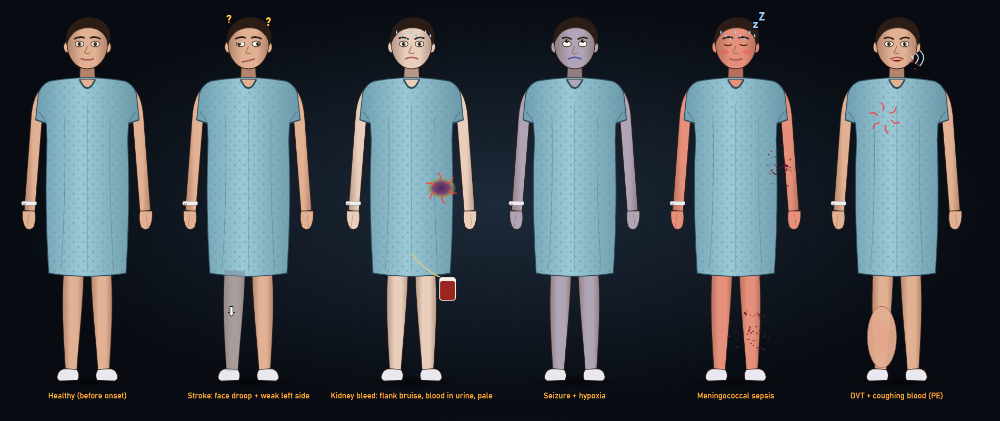
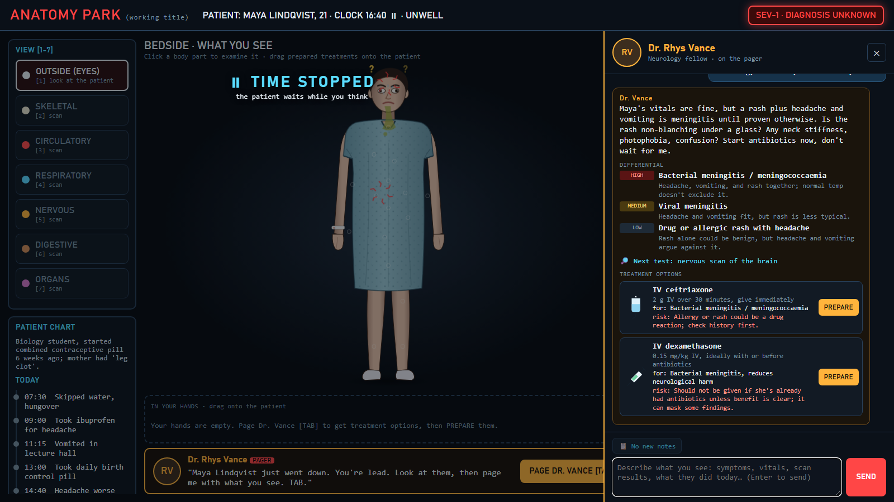

# ANATOMY PARK (working title)
**A live medical mystery. You're the lead doctor; your fellow is on the pager.**
WHACK 26 · incident.io track: *"Build an agent that reacts to a live feed as it happens, with personality."*

## v2 loop (House-style)
1. **Bedside view first:** you see what a human would see (face droop, bleeding, seizure, rash, pallor, cyanosis…).
2. **Scan the layers** underneath (skeletal / circulatory / respiratory / nervous / digestive / organs) with the nanobot.
3. **Page Dr. Vance (TAB):** game time STOPS. Type what you found; he only knows what you tell him + the monitor.
   He replies in character with a **differential**, the **next test**, and **treatment options**, each with a PREPARE button.
4. **Physically deliver it:** drag the item onto the patient: hold to inject, charge and release the defib paddles, click for CPR, drag the scalpel along the cut.
5. **The body reacts:** Claude (which knows the hidden diagnosis) decides cured / improving / no change / worse, with a realistic cascade and new visible symptoms. Then back to the pager.
6. **Incident post-mortem** at the end.




## How the AI is used (not a wrapper)
| Part | Who |
|---|---|
| Live body simulation: problems per site -> vitals, deterioration, death; pause while paging | **our code** (`sim.js`) |
| Patient art + symptom renderer (22 visual effects, scaled by live severity) | **our code** (`patient.js`) |
| Which effects a symptom shows from outside ("kidney bleed" -> flank bruise + blood in urine + pallor) | **Claude** `/visualize` |
| The fellow: differential, next test, real treatments, personality. He never sees the hidden case | **Claude** `/chat` |
| Ground truth: what the treatment you physically gave really does (delivery site matters) | **Claude** `/treat` (knows the case) |
| Item art for any treatment he invents (syringe, bag, paddles, scalpel…), drawn on the spot as SVG, sanitised + cached | **Claude** `/art` + instant built-in icon |
| Hidden case, findings per scan mode | **Claude** (case pool) |

Two separate Claude roles that can disagree: the fellow can be wrong (garbage in, garbage out); the physiology judge is not.

## Run
```bash
# backend (Claude), port 8010
cd backend
pip install fastapi "uvicorn[standard]" anthropic
cp .env.example .env    # put ANTHROPIC_API_KEY in .env
python -m uvicorn main:app --port 8010

# game, port 5173
cd frontend
npm install
npm run dev             # open http://localhost:5173
```
Keys 1-7 switch views (1 = bedside). TAB pages the fellow. Esc cancels a delivery. `#demo` in the URL skips the intro. If the backend is offline, built-in cases are used (`frontend/src/cases.json`).

## Team split (2 people)
**Builder (Memphis + Claude):** engine, Claude integration, cascades, vitals, post-mortem, polish of the game loop.
**Teammate (design + content + pitch):**
1. Improve the look from `design/mockup_v1.png`: body art per scan mode (SVG/PNG layers), the nanobot character, the Attending portrait, icons. Drop SVG/PNG files in `frontend/public/art/` and tell the builder.
2. Playtest cases: check that cases are fair and medically sensible, and note bad ones (they live in `backend/cache/`).
3. Sounds: heartbeat, monitor alarm, scan sweep (free SFX).
4. Pitch script (5 min) + Devpost text/images + the 20-30 s video.
5. Get judge feedback at each checkpoint.

## Status
- [x] mockup, body map + 6 scan modes, live vitals + ECG, the Attending, tests/evidence, treatments, cascades (Claude), post-mortem, case pool, offline fallback
- [ ] art pass, sounds, real-world input (patient heartbeat = your heartbeat via webcam/mic?), mini-fights in organs (P2)
