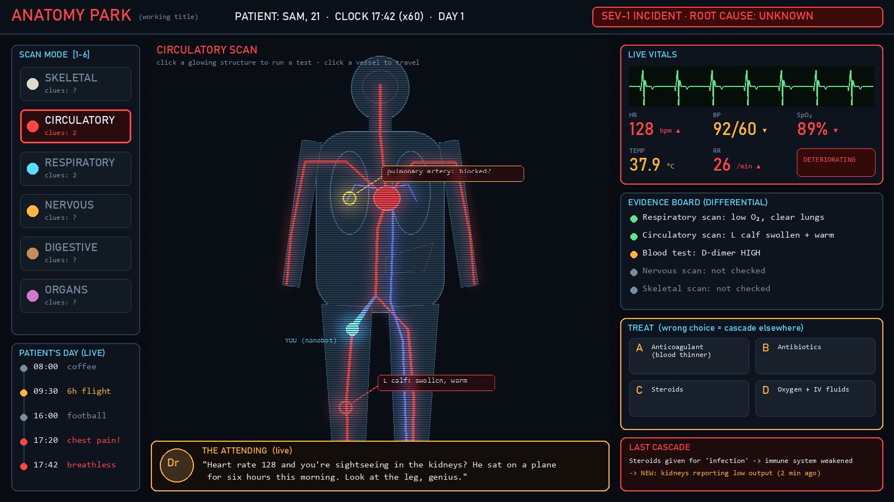

# ANATOMY PARK (working title)
**You're the on-call medic… inside a human body.**
WHACK 26 · incident.io track: *"Build an agent that reacts to a live feed as it happens, with personality."*

The patient lives their day live. Something goes wrong inside them: a clot, an infection, a tear, a genetic condition flaring up.
Switch scan modes (skeletal / circulatory / respiratory / nervous / digestive / organs, like detective vision), travel through the bloodstream,
run tests, and pick a treatment. A wrong treatment causes a realistic **cascade** in another system (House MD style). At the end you get an
**incident post-mortem**, which is literally a post-mortem.

> incident.io helps engineers respond to outages in real time. We made you the on-call engineer… for a human body.



## How the AI is used (not a wrapper)
| Part | Who |
|---|---|
| Live body simulation: problems per site → vitals (HR, BP, SpO₂, temp, RR), deterioration, death | **our code** (`frontend/src/sim.js`) |
| Body map, scan modes, bloodstream travel, tests, evidence, live ECG | **our code** |
| The Attending (personality) reacting instantly to the vitals feed | **our code** triggers + lines from Claude |
| Medical knowledge: the hidden case, the misleading symptoms, the findings per scan mode, the treatments, and what a wrong drug realistically does next | **Claude**, via strict JSON tools (`backend/schema.py`) |

Claude never sets numbers directly. It names sites, findings and treatments, and the engine simulates their effect.
Hot path vs cold path: reactions are instant (code); Claude plans ahead. Cases come from a pre-generated pool, and cascades for every wrong option are computed in the background before you click.

## Run
```bash
# backend (Claude), port 8010
cd backend
pip install fastapi "uvicorn[standard]" anthropic
cp .env.example .env    # put ANTHROPIC_API_KEY in .env
python -m uvicorn main:app --port 8010

# game, port 5173
cd frontend
npm install
npm run dev             # open http://localhost:5173
```
Keys 1-6 switch scan modes. Click a site to travel + test. If the backend is offline, built-in cases are used (`frontend/src/cases.json`).

## Team split (2 people)
**Builder (Memphis + Claude):** engine, Claude integration, cascades, vitals, post-mortem, polish of the game loop.
**Teammate (design + content + pitch):**
1. Improve the look from `design/mockup_v1.png`: body art per scan mode (SVG/PNG layers), the nanobot character, the Attending portrait, icons. Drop SVG/PNG files in `frontend/public/art/` and tell the builder.
2. Playtest cases: check that cases are fair and medically sensible, and note bad ones (they live in `backend/cache/`).
3. Sounds: heartbeat, monitor alarm, scan sweep (free SFX).
4. Pitch script (5 min) + Devpost text/images + the 20-30 s video.
5. Get judge feedback at each checkpoint.

## Status
- [x] mockup, body map + 6 scan modes, live vitals + ECG, the Attending, tests/evidence, treatments, cascades (Claude), post-mortem, case pool, offline fallback
- [ ] art pass, sounds, real-world input (patient heartbeat = your heartbeat via webcam/mic?), mini-fights in organs (P2)
